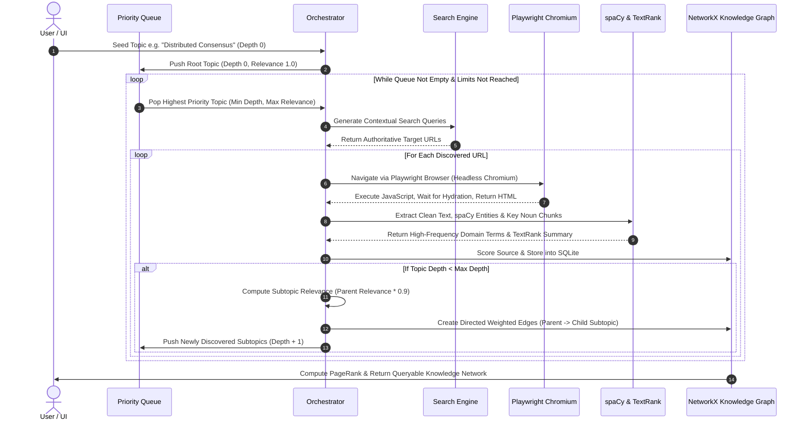
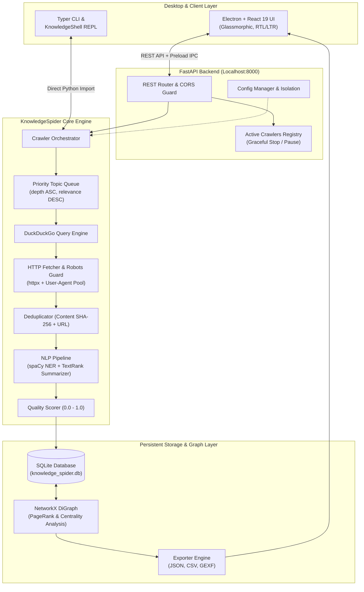

<div align="center">

# KnowledgeSpider

### Autonomous Web Crawling, NLP Entity Extraction & Knowledge Graph Discovery Engine

[](https://opensource.org/licenses/MIT)
[](https://www.python.org/)
[](https://fastapi.tiangolo.com/)
[](https://react.dev/)
[](https://www.typescriptlang.org/)
[](https://www.electronjs.org/)
[](https://networkx.org/)
[](https://github.com/mohammed18salah/data-spider/pulls)

<p align="center">
  <b>Transform any seed topic into an interconnected, queryable knowledge graph — 100% local, autonomous, and free of proprietary API tokens.</b>
</p>

[Overview](#overview) •
[Comparison Matrix](#why-knowledgespider-competitive-comparison) •
[How It Works](#how-it-works-autonomous-exploration--deep-branching-engine) •
[Anti-Bot & Playwright](#anti-bot-protection--javascript-handling-playwright-engine) •
[KnowledgeSpider vs OpenClaw & AI Agents](#detailed-comparison-knowledgespider-vs-openclaw--agentic-ai-scrapers) •
[System Architecture](#system-architecture) •
[Quick Start](#quick-start) •
[Desktop App](#desktop-app--ui) •
[CLI & Shell](#cli--interactive-shell) •
[REST API](#rest-api-reference) •
[Roadmap](#open-source-roadmap)

---

</div>

## Overview

**KnowledgeSpider** is an open-source autonomous web discovery and knowledge-synthesis system. Given any single keyword or seed topic (e.g. *"Quantum Computing"*, *"Cybersecurity Frameworks"*, or *"Domain Name System"*), KnowledgeSpider autonomously:

1. **Searches & Explores**: Queries privacy-focused search engines (DuckDuckGo) and discovers authoritative web sources.
2. **Fetches & Sanitizes**: Parses HTML content, adheres strictly to `robots.txt`, rotates user agents, and filters out boilerplate/low-value markup.
3. **NLP Knowledge Pipeline**: Leverages **spaCy** for Named Entity Recognition (NER) and noun chunking, coupled with **sumy TextRank** for extractive multi-sentence summaries.
4. **Calculates Multi-Dimensional Quality Scores**: Rates each source from `0.0` to `1.0` using domain authority, text density, relevance decay, and content length.
5. **Synthesizes Directed Knowledge Graphs**: Constructs high-dimensional topic relationship graphs using **NetworkX**, computing **PageRank** and centrality to reveal foundational domain concepts.
6. **Local-First Persistence**: Stores complete crawl history, nodes, edges, terms, and session snapshots into a lightweight, local **SQLite** database via **SQLModel**.
7. **Dual-Interface Access**: Operate via a cross-platform **Electron + React 19** desktop GUI (featuring dark mode and Arabic/English localization) or through an interactive **CLI REPL Shell**.

---

## Why KnowledgeSpider? Competitive Comparison

Most existing web scrapers either require manual rule-writing, dump unstructured plain text, or rely on expensive, non-deterministic cloud LLMs. Here is how KnowledgeSpider compares against standard scrapers and modern AI crawling platforms:

| Feature / Dimension | **KnowledgeSpider** | **Scrapy** | **AutoGPT / Agent Scrapers** | **Crawl4AI / Firecrawl** | **Neo4j / Memgraph Stacks** |
| :--- | :---: | :---: | :---: | :---: | :---: |
| **Autonomous Topic Discovery** | **Built-in** (automatic search & branch) | Manual spiders & link extractors | Supported, but prone to drifting | URL-based scraping only | Graph only, no crawler |
| **NLP Entity & Noun Extraction** | **Built-in (spaCy local)** | Requires custom pipelines | Requires cloud LLM tokens | Markdown / LLM extraction | Manual ingestion |
| **Extractive Summarization** | **Built-in (TextRank)** | None | Expensive LLM tokens | Markdown summary | None |
| **Integrated Knowledge Graph** | **Built-in (NetworkX + PageRank)** | None | None (raw text output) | None | Yes (requires DB server) |
| **Cost per 1,000 Pages** | **$0.00 (100% Free & Local)** | $0.00 | $5.00 – $30.00 (OpenAI/Anthropic) | Token / Subscription cost | Server infrastructure cost |
| **Desktop GUI Included** | **Yes (Electron + React 19)** | Terminal only / Scrapyd | Web dashboard or terminal | Web dashboard | Web browser tool |
| **Multilingual UI (AR / EN)** | **Yes (RTL + LTR Native)** | None | English-first | English-first | English-first |
| **Local-First & Zero Telemetry** | **SQLite (Single-file DB)** | Files / SQLite | Cloud telemetry / Third-party APIs | Hosted or local Docker | Heavy Docker instances |
| **Deterministic Quality Scoring** | **Configurable Formula** | Manual coding | Non-deterministic / LLM variance | Basic heuristics | None |
| **Interactive Terminal Shell** | **Rich REPL Shell** | Scrapy Shell (page only) | Chat loop | None | Cypher shell |

---

## How It Works: Autonomous Exploration & Deep-Branching Engine

Unlike standard scrapers that demand predefined sitemaps or static link lists, KnowledgeSpider acts as an autonomous conceptual cartographer. It discovers, explores, and deep-dives into unfamiliar domains through a 6-stage closed-loop pipeline:



### The Deep-Dive Mechanism Explained:
1. **Seed Initiation (Depth 0)**: You supply a seed topic. The engine creates a `TopicModel(depth=0, relevance=1.0)` and marks it as queued.
2. **Contextual Query Generation**: The engine formulates multi-angle search queries (e.g. `"Distributed Consensus overview"`, `"Distributed Consensus architecture"`, `"Distributed Consensus protocols"`) to capture diverse viewpoints.
3. **Execution & Text Hygiene**: A real browser engine downloads the content, removes boilerplate/navigation junk, and validates minimum word-count thresholds (`min_content_words = 150`).
4. **NLP Concept Extraction**: spaCy extracts multi-word noun chunks and named entities, analyzing term frequency and contextual prominence.
5. **Recursive Branching (The Deep-Hop)**:
   - The top $N$ extracted concepts (`max_topics_per_page = 8`) are promoted to **child subtopics** with `depth = parent_depth + 1`.
   - Relevance decay is applied: $\text{Relevance}_{\text{child}} = \text{Relevance}_{\text{parent}} \times 0.90$.
   - A directed weighted edge is registered in SQLite and NetworkX.
6. **Priority-Queue Ordering**: The `TopicQueueManager` uses a min-heap ordered by `(depth ASC, -relevance ASC)`. This guarantees breadth-first conceptual integrity before digging into deeper niche layers, preventing dead-end rabbit holes.

---

## Anti-Bot Protection & JavaScript Handling (Playwright Engine)

Modern web pages are frequently built as dynamic client-side Single Page Applications (SPAs using React, Angular, or Vue) or guarded by anti-bot verification challenges (Cloudflare, Akamai, or basic CAPTCHA gates). Traditional HTTP client libraries (such as `requests`, `urllib`, or raw `curl`) fail on these sites with blank pages or immediate `403 Forbidden` errors.

KnowledgeSpider solves this with an integrated browser automation layer:

### 1. Real Headless Chromium Engine (Playwright)
Rather than firing synthetic HTTP GET requests, KnowledgeSpider launches a headless Chromium instance via **Playwright**:
- **Full JavaScript Hydration**: Waits for `domcontentloaded` and client-side scripts to evaluate before extracting HTML.
- **Client-Side Rendering**: Intercepts SPAs and dynamic feeds that cannot be scraped with static parsers.

### 2. Realistic Desktop Device Fingerprinting
- Configures real desktop viewport dimensions (`1280x720`).
- Rotates modern desktop Chrome / Windows user-agent strings.
- Emulates realistic browser platform attributes and headers (`Accept-Language`, `Sec-Ch-Ua`, etc.), bypassing basic bot-detection scripts.

### 3. Human-Emulation Delays & Polite Crawling
- **Adaptive Crawl Delay**: Enforces a configurable pause (`crawl_delay_seconds = 2.0s`) between consecutive page navigations.
- **Strict `robots.txt` Compliance**: Checks site rules via `is_crawl_allowed()` to prevent aggressive crawling patterns that trigger automated IP blacklists.

### 4. Authoritative Domain Scoring Strategy
- Prioritizes trusted, open knowledge repositories (Wikipedia, RFC Editor, ArXiv, MDN Web Docs, GitHub, Python Docs) where content is high-signal, peer-reviewed, and rarely gated behind aggressive CAPTCHAs.
- In-memory and SQLite-backed **SHA-256 deduplication** ensures a visited URL is never re-requested, eliminating suspicious high-frequency access patterns.

---

## Detailed Comparison: KnowledgeSpider vs OpenClaw & Agentic AI Scrapers

How does KnowledgeSpider differ from tools like **OpenClaw** or recent **autonomous AI web agents** (e.g. ScrapeGraphAI, AutoGPT web tools, BrowserGym)?

### 1. KnowledgeSpider vs OpenClaw
| Dimension | KnowledgeSpider | OpenClaw / Repo Crawlers |
| :--- | :--- | :--- |
| **Primary Goal** | **Autonomous Domain Knowledge Discovery**: Builds an interconnected concept graph from any topic. | **Targeted Extraction / Auditing**: Focused on predefined website scraping, PR reviews, and repo audits. |
| **Input Required** | **A single idea or keyword** (e.g. `"Raft Consensus"`). | **Specific URLs, sitemaps, or repository targets**. |
| **Exploration Model** | Autonomous recursive branching across the open web. | Pre-configured target scraping without conceptual branching. |
| **Output Type** | Directed NetworkX Knowledge Graph, PageRank centrality scores, and entities. | Flat files, code diffs, or specific extracted data points. |

### 2. KnowledgeSpider vs AI Data Gathering Agents (LLM-in-the-Loop)
Modern autonomous AI agents (such as ScrapeGraphAI, AutoGPT, or Multi-Agent Web Seekers) operate by feeding entire raw HTML / accessibility trees into cloud LLMs on every single action:

```
Typical AI Agent Loop (Slow & Expensive):
Page HTML -> Cloud LLM ($$$ per token) -> Parse Plan -> Click/Navigate -> Cloud LLM ($$$) -> Next Page ...
Cost: ~$0.05 to $0.20 PER PAGE. 200 pages = $10.00 – $40.00+
```

```
KnowledgeSpider Engine Loop (Instant & Free):
Page HTML -> Playwright Chromium -> Local spaCy NER -> TextRank -> NetworkX -> SQLite
Cost: $0.00. 100% Deterministic. Zero API latency. Zero token limits.
```

#### Key Differentiators of KnowledgeSpider:
* **Zero Token Cost ($0.00)**: No recurring OpenAI / Anthropic bills. You can crawl 10,000 pages for free on consumer hardware.
* **No Drift / Hallucination**: AI agents frequently lose focus after 2-3 hops (e.g. searching for "Kubernetes" and ending up on a cloud provider's pricing calculator). KnowledgeSpider uses mathematical relevance scoring and queue prioritization to stay strictly bound to the subject matter.
* **Topological Concept Maps vs Raw Text Dumps**: AI scrapers output disconnected markdown files. KnowledgeSpider outputs an interconnected knowledge graph with PageRank metrics identifying which terms are the foundational pillars of the domain.
* **Turnkey Desktop App**: Includes a native Electron + React 19 GUI with bilingual (Arabic/English) support and local SQLite management—not just an experimental command-line script.

---

## What Makes KnowledgeSpider a Standout Open-Source Project?

- **Zero Cloud Lock-in & Privacy First**: No OpenAI/Anthropic API keys required. Everything runs locally on your machine using spaCy, NLTK, and sumy.
- **RAG-Ready Structured Outputs**: Directly feeds modern Vector Databases and RAG pipelines (LangChain, LlamaIndex, Ollama, ChromaDB) with pre-extracted entities and PageRank-weighted summaries.
- **Hardened Security Architecture**:
  - Electron uses `contextIsolation: true`, `nodeIntegration: false`, and `sandbox: true`.
  - FastAPI backend enforces strict origin whitelisting (No wildcard `*` CORS exploits).
  - SQLModel prepared statements prevent SQL injection.
- **Resilient Process Architecture**:
  - Background crawler task with **Graceful Stop** (`/api/crawl/stop`) so crawls can be paused and resumed without data loss.
  - Isolated session configurations (`get_session_config`) that prevent global singleton pollution.
- **Accessible to Both Developers and Researchers**:
  - Developers can integrate via Python SDK, REST API, or CLI.
  - Researchers and non-programmers can launch the one-click desktop app with visual progress and live charts.

---

## System Architecture

The following diagram illustrates the complete end-to-end data processing lifecycle inside KnowledgeSpider:



---

## Repository Layout

```text
data-spider/
├── backend/
│   ├── knowledge_spider/       # Core Python Engine
│   │   ├── cli/                # Typer CLI and Interactive Shell (REPL)
│   │   ├── core/               # Configuration, Session Lifecycle, Queue Manager, Orchestrator
│   │   ├── crawler/            # Fetcher (httpx), Parser (BS4), Robots parser, Deduplicator
│   │   ├── expansion/          # Autonomous Query & Topic expansion
│   │   ├── export/             # JSON & CSV Exporter modules
│   │   ├── knowledge/          # NetworkX Graph Manager, PageRank, Centrality
│   │   ├── nlp/                # spaCy Named Entity Extraction & sumy TextRank Summarizer
│   │   ├── query/              # DuckDuckGo search integration
│   │   ├── scoring/            # Composite multi-factor source quality scoring
│   │   ├── storage/            # SQLModel database models, SQLite engine & CRUD
│   │   └── utils/              # Thread-safe logging, SHA-256 hashing, language detection
│   ├── tests/                  # Comprehensive test suite (Unit & Integration)
│   ├── config.toml             # Central runtime configuration
│   ├── main.py                 # FastAPI server with CORS & Graceful Stop
│   ├── pyproject.toml          # Standard Python packaging configuration
│   └── requirements.txt        # Backend dependencies
│
├── frontend/
│   ├── electron/               # Electron Main process & secure Preload bridge
│   │   ├── main.js             # Electron main process (spawns Python backend)
│   │   └── preload.cjs         # ContextBridge security isolation script
│   ├── src/                    # React 19 Frontend
│   │   ├── App.tsx             # Main Application dashboard & History viewer
│   │   ├── index.css           # Glassmorphic UI Design System (RTL/LTR, Dark/Light)
│   │   └── main.tsx            # React application entry point
│   ├── package.json            # Frontend & Electron scripts and dependencies
│   └── vite.config.ts          # Vite build and development configuration
│
└── README.md                   # Project documentation
```

---

## Quick Start

### Prerequisites

- **Python**: `3.11` or higher
- **Node.js**: `18.0.0` or higher
- **npm** or **pnpm** / **yarn**

---

### Step 1: Backend Setup

1. Navigate to the backend directory:
   ```bash
   cd backend
   ```

2. Create and activate a Python virtual environment:
   ```bash
   # Windows (PowerShell)
   python -m venv .venv
   .venv\Scripts\Activate.ps1

   # Linux / macOS
   python3 -m venv .venv
   source .venv/bin/activate
   ```

3. Install backend dependencies and the spaCy language model:
   ```bash
   pip install -r requirements.txt
   python -m spacy download en_core_web_sm
   ```

4. *(Optional)* Install in editable mode:
   ```bash
   pip install -e .
   ```

5. Run the FastAPI development server:
   ```bash
   python main.py
   # Or using uvicorn:
   uvicorn main:app --host 127.0.0.1 --port 8000 --reload
   ```
   > The API will be accessible at: `http://127.0.0.1:8000` (Interactive docs at `/docs`).

---

### Step 2: Frontend & Desktop App Setup

1. In a separate terminal, navigate to the frontend directory:
   ```bash
   cd frontend
   ```

2. Install dependencies:
   ```bash
   npm install
   ```

3. **Run in Web Browser mode**:
   ```bash
   npm run dev
   ```
   > Access the web dashboard at `http://localhost:5173`.

4. **Run as Desktop App (Electron)**:
   ```bash
   npm run electron:dev
   ```
   > Automatically boots both the Vite dev server and the Electron desktop application.

---

## Desktop App & UI

The KnowledgeSpider desktop GUI is engineered for high productivity and intuitive visual monitoring:

- **Bilingual Interface**: Seamlessly switch between **العربية (RTL)** and **English (LTR)** with a single click.
- **Glassmorphic Dark & Light Modes**: Tailored color palettes with ambient mesh gradients and smooth transitions.
- **Live Crawl Monitoring**: Real-time timer, analyzed sources counter, active search queries, and expandable logs.
- **Depth & Source Limit Controls**: Adjust parameters on the fly via smooth slider inputs.
- **One-Click Data Export**: Instant download of structured JSON exports.
- **History Management**: Review previous crawl runs, examine status badges, and safely delete obsolete sessions.

---

## CLI & Interactive Shell

KnowledgeSpider includes a full-featured Command Line Interface built with **Typer** and **Rich**.

### Start a Crawl from Terminal

```bash
# Basic crawl
python -m knowledge_spider start "Artificial Intelligence"

# Custom depth and source limits
python -m knowledge_spider start "Distributed Systems" --max-depth 2 --max-sources 25
```

### Inspect Stored Sessions

```bash
python -m knowledge_spider sessions
```

### Resume a Paused Crawl

```bash
python -m knowledge_spider resume <session-id>
```

### Interactive Knowledge Graph REPL

Explore nodes, relationships, and source summaries directly in your terminal:

```bash
python -m knowledge_spider shell <session-id>
```

Inside the interactive shell:
```text
spider[c4a189f2]> summary
   Total Nodes: 14
   Total Edges: 22
   Top Concepts (PageRank):
     1. Domain Name System (Score: 0.284)
     2. Authoritative Name Server (Score: 0.198)
     3. DNSSEC (Score: 0.142)

spider[c4a189f2]> explore "DNSSEC"
   Discovered connections from 'DNSSEC':
     → Public Key Cryptography (weight: 0.92)
     → Root Zone (weight: 0.85)

spider[c4a189f2]> sources "DNSSEC"
   [1] RFC 4033 - DNS Security Introduction (Score: 0.94)
       Summary: An introduction to the DNS Security Extensions...

spider[c4a189f2]> exit
```

---

## Configuration (`config.toml`)

All runtime behavior is controlled centrally via `backend/config.toml`:

```toml
[crawler]
max_depth            = 3        # Maximum recursion depth from seed topic
max_sources          = 200      # Stop after harvesting N high-quality pages
time_limit_minutes   = 60       # Global timeout safeguard
crawl_delay_seconds  = 2.0      # Respectful rate-limiting delay between requests
max_urls_per_query   = 5        # URLs grabbed per search query
respect_robots       = true     # Respect robots.txt directives
trusted_only         = false    # If true, restrict to trusted_domains

[nlp]
min_content_words      = 150    # Skip thin/junk content
relevance_threshold    = 0.45   # Minimum keyword match to retain topic
max_topics_per_page    = 8      # Maximum child subtopics to branch per page
summary_sentence_count = 5      # Sentences in TextRank extractive summary

[scoring]
domain_weight    = 0.35         # Weight of domain authority score
content_weight   = 0.15         # Weight of word count & term richness
relevance_weight = 0.35         # Weight of semantic relevance to seed
freshness_weight = 0.15         # Weight of recent discovery / timestamp
# Note: Scoring weights must sum to exactly 1.0

[trusted_domains]
domains = [
  "wikipedia.org",
  "developer.mozilla.org",
  "arxiv.org",
  "rfc-editor.org",
  "docs.python.org",
  "github.com",
]
```

---

## REST API Reference

| Method | Endpoint | Description |
| :--- | :--- | :--- |
| `GET` | `/` | System health and API version |
| `POST` | `/api/crawl` | Start a new background crawl session with parameters |
| `POST` | `/api/crawl/stop` | Gracefully stop all active crawler instances |
| `POST` | `/api/crawl/{session_id}/stop` | Gracefully stop a specific session |
| `GET` | `/api/session/{session_id}` | Fetch real-time metrics (sources, topics, edges, quality) |
| `DELETE`| `/api/session/{session_id}` | Cascade delete session and all associated graph data |
| `GET` | `/api/graph/{session_id}` | Retrieve graph topology, nodes, edges, and PageRank summary |
| `GET` | `/api/export/{session_id}` | Retrieve full structured JSON export payload |
| `GET` | `/api/sessions` | List all previous crawl sessions |
| `GET` | `/api/config` | Retrieve current runtime system configuration |
| `POST` | `/api/config` | Dynamically update runtime system settings |

---

## Testing & Validation

KnowledgeSpider includes a 22-step automated verification suite covering database models, NLP summarizers, deduplication, robots parsing, and graph algorithms:

```bash
cd backend

# Run the test suite
python tests/test_new_fixes.py
python tests/test_step0.py
python tests/test_step1.py
python tests/test_step2.py
python tests/test_step3.py
```

To validate the frontend build:
```bash
cd frontend
npm run build
```

---

## Open-Source Roadmap

- [x] **v1.0 (Current)**:
  - Autonomous search-driven crawling loop
  - spaCy NER and TextRank summarization
  - NetworkX knowledge graph synthesis and PageRank scoring
  - Local SQLite persistence with pause/resume support
  - Electron + React 19 desktop GUI with Dark/Light and Arabic/English modes
  - Hardened Electron IPC & strict FastAPI CORS
- [ ] **v1.1 (Upcoming)**:
  - 3D interactive knowledge graph visualizer (Three.js / React Force Graph) inside the desktop app.
  - Export to GEXF / GraphML directly from the UI.
  - Native PDF document crawling and text extraction.
- [ ] **v1.2**:
  - Optional local LLM integration via **Ollama** for question-answering over discovered knowledge graphs.
  - One-click export to Vector Databases (Chroma, Qdrant, LanceDB).

---

## Contributing

Contributions are warmly welcomed! KnowledgeSpider thrives on community ideas, bug reports, and pull requests.

1. **Fork** the repository.
2. **Create** a feature branch: `git checkout -b feat/amazing-feature`.
3. **Commit** your changes: `git commit -m 'feat: add amazing feature'`.
4. **Push** to your branch: `git push origin feat/amazing-feature`.
5. **Open** a Pull Request.

Please make sure to run tests and follow clean code conventions before opening PRs.

---

## License

This project is licensed under the **MIT License** — see the [LICENSE](LICENSE) file for details. Free for commercial and personal use.

---

<div align="center">
  <sub>Built by the KnowledgeSpider Team. If you find this project useful, please consider starring the repository on GitHub!</sub>
</div>
